# Polestar FlexRay box: bench test before it goes in the car

Tools: a multimeter (ohms, continuity, diode, DC volts, DC mA) and a current-limited DC bench supply.
Nothing here needs the car, the comma device or a USB cable.

Expected values come from the schematic as of 2026-11-16 (U3 = LM53601, R10 = 3.3 kΩ).

**Stop at the first failure.** Every step exists to catch something that could hurt the car or the box.

Each step has a picture rendered from the KiCad 3D model, with markers placed from the actual pad coordinates.

## Finding pins

- **Pad numbers:** the bottom-view pictures (steps 1.3, 1.4, 2.4) number every J3/J4 pin. You can also hover a pad in KiCad's PCB editor. On the solder side, the board's silkscreen marks pin 13 "GND" and pin 26 "12V", a handy cross-check.
- **J3/J4 (JAE 32-pin):** probe their solder joints from the back of the board.
- **J2 power input:** pad 4 is **+12 V** (silk "VIN"), pad 3 is **GND** (silk "GND"). Pads 1 and 2 are unused.
- **Board GND:** J2 pad 3, or the GND end of any decoupling cap.
- **Measurement points used below** (probe the cap's non-GND pad):

| Rail | Probe at |
|---|---|
| VIN | C6 or C24 |
| +5V | C9 or C5 |
| +5V_XIAO | C26 |
| +3V3 | C7 or C25 |
| SW_VCC (DG419 supply) | C28 |

---

## Part 1: unpowered checks

### 1.1 Visual

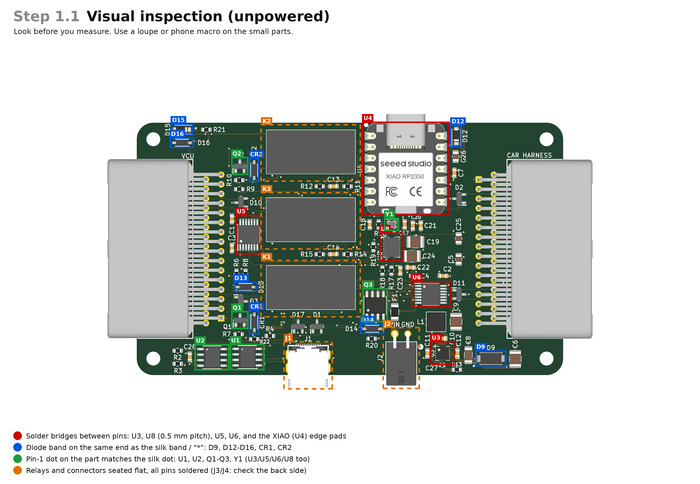

- [ ] Look for solder bridges on U3, U8 (the small QFNs), U5/U6 and the XIAO's edges.
- [ ] Every diode's band sits where the silk band/`*` is.
- [ ] Check every IC's pin-1 dot against the silk.
- [ ] No parts missing; K1–K3, J1–J4 and J2 seated flat.

### 1.2 No shorts on the power rails

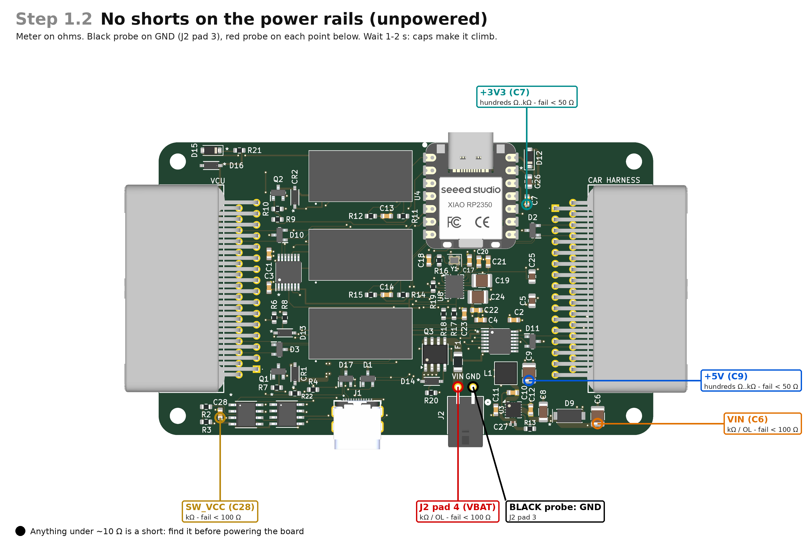

Measure with red on the rail and black on GND. Caps make the reading climb, so read the value after a second or two.

| From → GND | Expected | Fail if |
|---|---|---|
| J2 pad 4 (VBAT) | high / climbing (kΩ or OL) | < 100 Ω |
| VIN | high / climbing | < 100 Ω |
| +5V | hundreds of Ω to kΩ | < 50 Ω |
| +3V3 | hundreds of Ω to kΩ | < 50 Ω |
| SW_VCC | kΩ | < 100 Ω |

A reading under ~10 Ω is a short. Find it before you power the board.

### 1.3 Passthrough continuity (box unpowered = box "invisible" to the car)

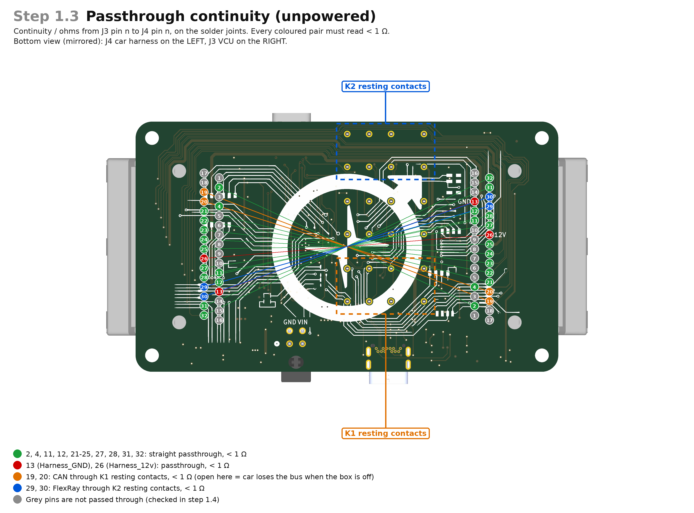

Most car signals just pass J3 → J4. Each of these must read **< 1 Ω** from J3 pin *n* to J4 pin *n*:

| Pins | Notes |
|---|---|
| 2, 4, 11, 12, 21, 22, 23, 24, 27, 28, 31, 32 | plain passthrough |
| 13 | Harness_GND |
| 25 | IGN |
| 26 | Harness_12v |
| 19, 20 | camera CAN, through **K1's normally-closed contacts** |
| 29, 30 | FlexRay, through **K2's normally-closed contacts** |

If 19/20 or 29/30 is open with the box unpowered, the car loses that bus whenever the box is off. Don't install the box until it's fixed.

### 1.4 Isolation: nothing from the car may touch the box's own power

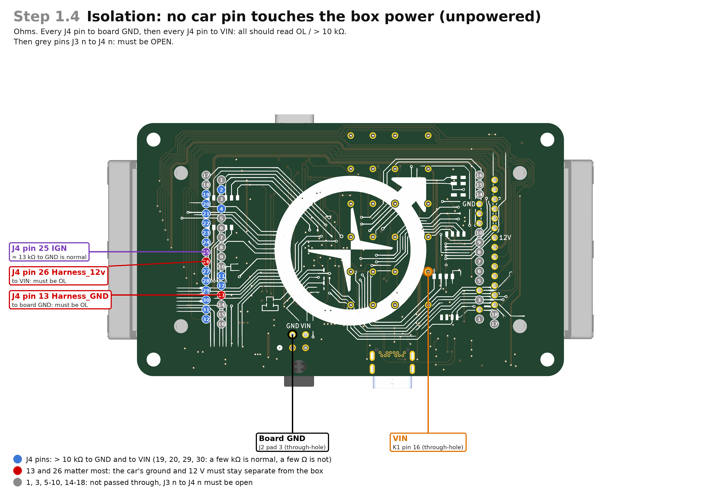

On **J4**, measure every pin 1–32 against **board GND** and against **VIN** (C6). All should read **OL / high (> 10 kΩ)**.

The pins that matter most:

| Pin | Must not touch | Why |
|---|---|---|
| 13 (Harness_GND) | board GND | It's deliberately kept separate from board GND. |
| 26 (Harness_12v) | VIN | The car's 12 V feed must not touch the box's supply. |
| 25 (IGN) | board GND | Expect about 13 kΩ to GND, through R6 + R8. |

On the FlexRay and CAN pins (19, 20, 29, 30) a few kΩ to GND is normal (transceiver bias and ESD diodes); a few ohms is not.

Also check that pins not passed through are open J3 ↔ J4: **1, 3, 5–10, 14–18**.

### 1.5 No termination on the car's buses while unpowered

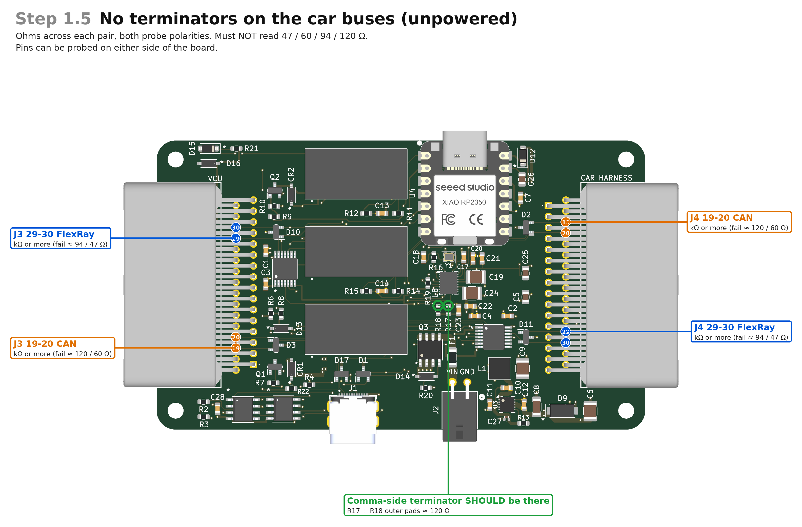

These pairs must **not** show a terminator. A reading of 47–120 Ω here means the box would load the car's bus.

| Pair | Expected (unpowered) | Fail if |
|---|---|---|
| J3.29 ↔ J3.30 (FlexRay) | kΩ or higher | ≈ 94 Ω or ≈ 47 Ω |
| J4.29 ↔ J4.30 (FlexRay) | kΩ or higher | ≈ 94 Ω or ≈ 47 Ω |
| J3.19 ↔ J3.20 (CAN) | kΩ or higher | ≈ 120 Ω or ≈ 60 Ω |
| J4.19 ↔ J4.20 (CAN) | kΩ or higher | ≈ 120 Ω or ≈ 60 Ω |

Measure each pair both ways round, since diodes inside the transceivers make the readings polarity-dependent.

The comma-side terminator *should* be there: R17 + R18 across the TCAN4550 pair, read on R17/R18's outer pads, ≈ **120 Ω**.

---

## Part 2: powered from the bench supply

Supply set to **12.0 V, current limit 100 mA**, output off. Connect + to J2 pad 4 and − to J2 pad 3.

### 2.1 Reverse-polarity check (first, while the limit is low)

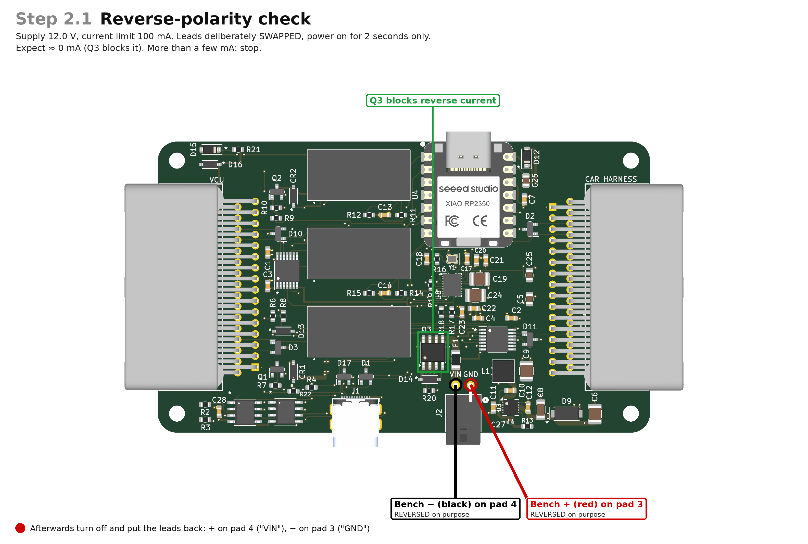

- [ ] Swap the leads (+ to pad 3, − to pad 4) and turn on for 2 seconds.
- [ ] **Expect ≈ 0 mA**: Q3 blocks a reversed battery. More than a few mA means Q3 or D9 is wrong.
- [ ] Turn off and put the leads back the right way.

### 2.2 First power-up

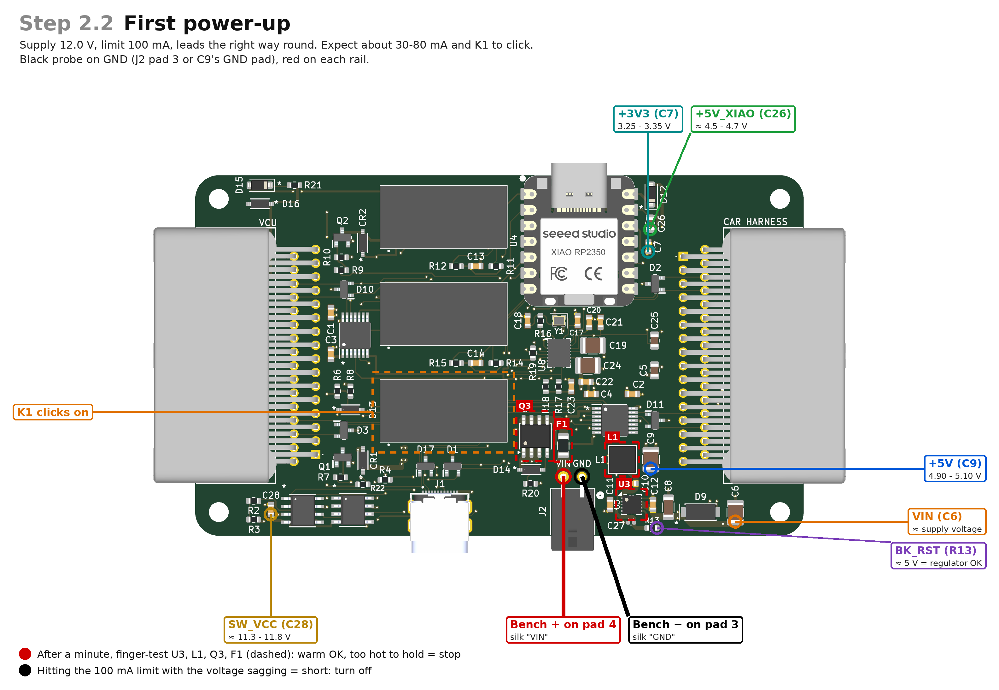

- [ ] Turn on at 12.0 V / 100 mA. **K1 should click** (it's energised whenever the box has power).
- [ ] **Current:** expect roughly **30–80 mA**. That's K1's coil (12.5 mA), the buck, the XIAO and the transceivers, and depends on what firmware is loaded.
  - If the supply hits the 100 mA limit and the voltage sags, turn off and look for a short.
- [ ] Measure the rails:

| Rail | Expected |
|---|---|
| VIN | ≈ supply voltage (Q3 drops almost nothing) |
| +5V | 4.90–5.10 V |
| +5V_XIAO | ≈ 4.5–4.7 V (one Schottky below +5V) |
| +3V3 | 3.25–3.35 V |
| SW_VCC | ≈ 11.3–11.8 V at 12 V in |
| U3 pin 6 (BK_RST, at R13) | ≈ 5 V; this is "regulator OK" |

- [ ] After a minute, touch-test U3, L1, Q3 and F1. Warm is fine; too hot to hold is not.

### 2.3 Input range

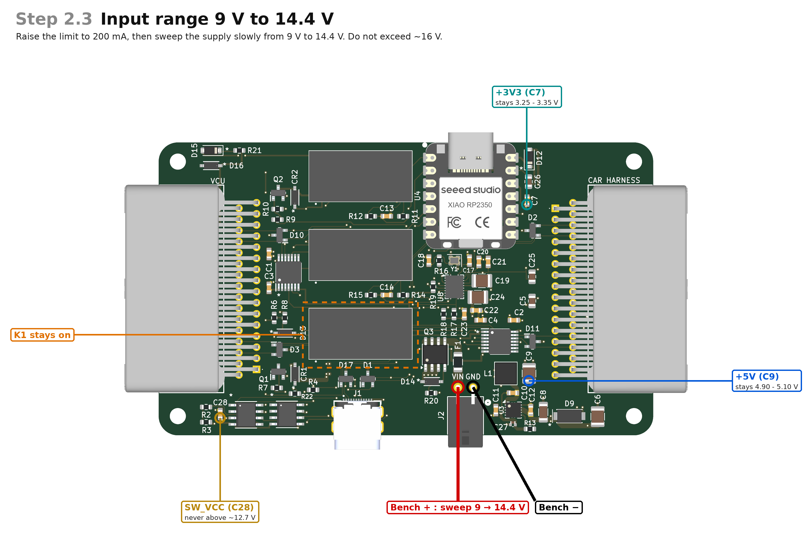

Slowly sweep the supply from **9 V to 14.4 V** (once the board is OK, raise the limit to 200 mA).
- [ ] +5V and +3V3 stay put across the sweep.
- [ ] SW_VCC never exceeds ~12.7 V (D16 clamps it).
- [ ] K1 stays energised.

Don't go above ~16 V: D9 (SMAJ16A) starts conducting around 17.8 V and the fuse is the next stop.

### 2.4 Nothing from the box drives the car's pins

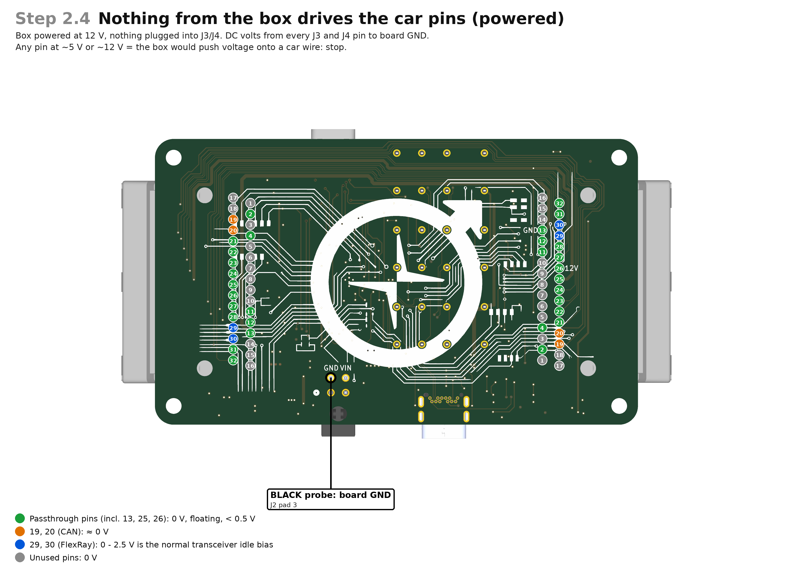

This is the key "won't fry the car" check. With the box powered at 12 V and **nothing plugged into J3/J4**, measure DC volts from every **J4** pin (and J3 pin) to board GND.

| Pins | Expected |
|---|---|
| All passthrough pins (2, 4, 11–13, 21–28, 31, 32) | **0 V** (floating, < 0.5 V) |
| 19, 20 (CAN) | ~0 V (DG419 switches only, no driver) |
| 29, 30 (FlexRay) | 0–2.5 V (normal transceiver idle bias) |

**Fail:** any pin showing ~5 V or ~12 V. That would be the box pushing voltage onto a car line.

### 2.5 Relay switching (optional, checks the MITM path)

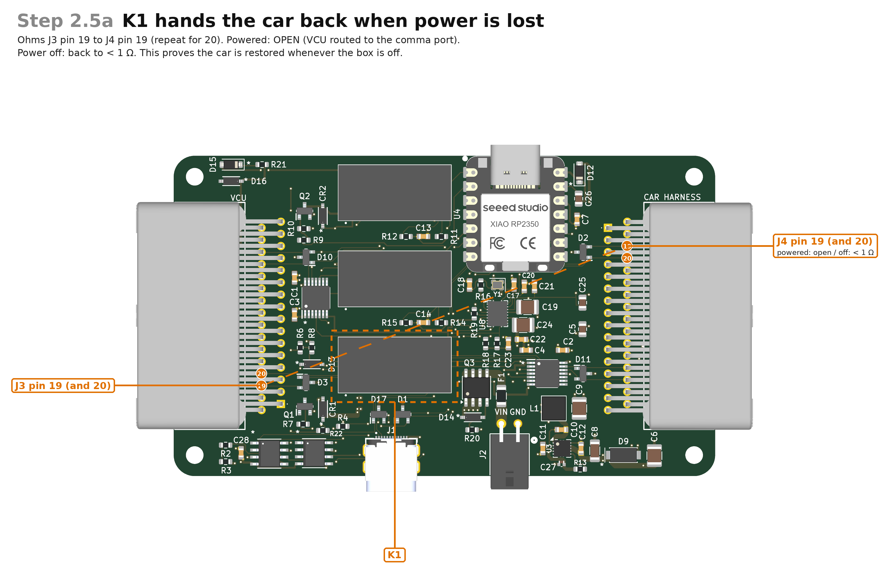

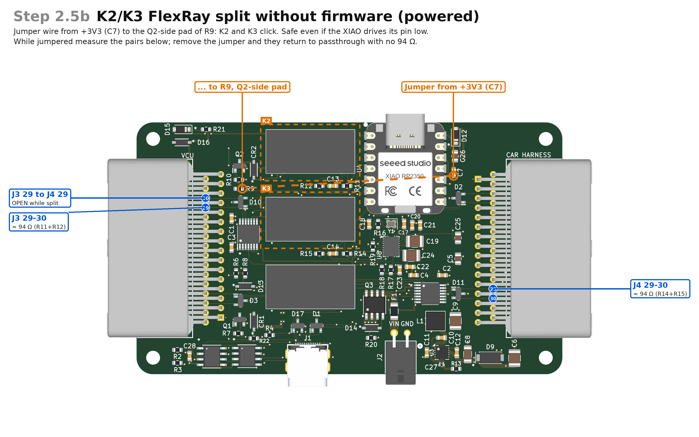

**K1 (VCU ↔ comma).** With the box powered, K1 is switched:
- [ ] J3.19 ↔ J4.19 now reads **open** (the VCU is routed to the comma connector instead).
- [ ] Power off: J3.19 ↔ J4.19 returns to **< 1 Ω**. This is your proof the car is restored when the box loses power.

**K2/K3 (FlexRay split).** Without firmware:
- [ ] Jumper **+3V3** (C7) to the **Q2-side pad of R9** (net FR_RLY_GATE). K2 and K3 should click. This is safe even if the XIAO is driving its pin low: about 3 mA through R9.
- [ ] While jumpered, measure:

| Pair | Expected while split |
|---|---|
| J3.29 ↔ J4.29 | **open** (bus split) |
| J3.29 ↔ J3.30 | **≈ 94 Ω** (R11 + R12, ECU-side termination) |
| J4.29 ↔ J4.30 | **≈ 94 Ω** (R14 + R15, car-side termination) |

- [ ] Remove the jumper. Both relays release, and 29/30 go back to < 1 Ω through, with no 94 Ω across.

Ohm readings on relay contacts are fine with the box powered, because nothing is driving those lines on the bench. If a reading wanders, power off and re-check the passthrough state (1.3/1.5).

### 2.6 Ignition sense (optional)

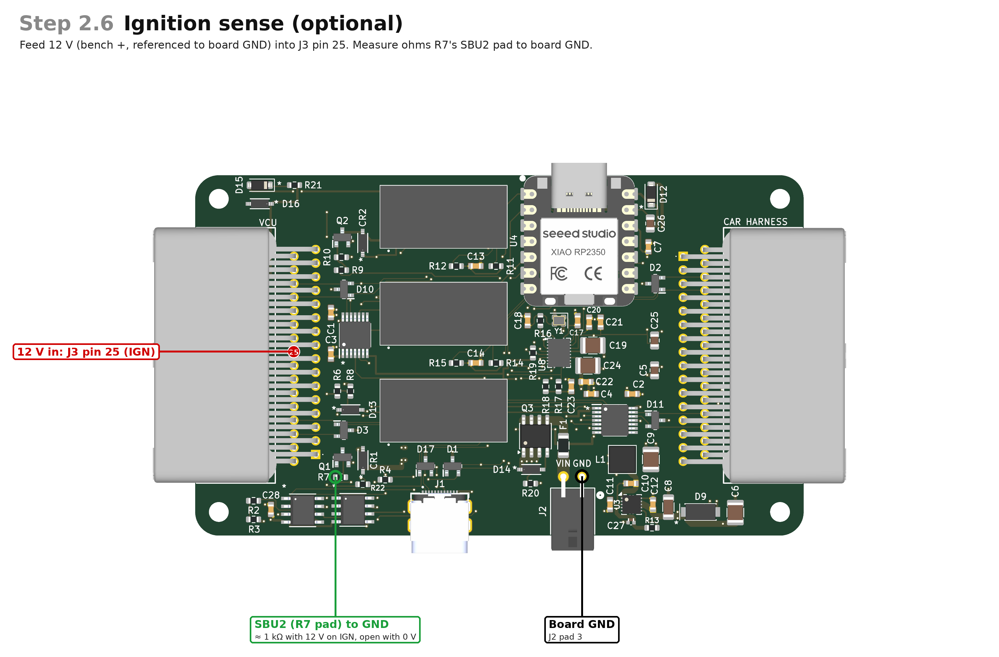

- [ ] Feed the bench supply's + (or a second 12 V source referenced to board GND) into **J3 pin 25 (IGN)**.
- [ ] Measure R7's comma-side pad (SBU2) to GND: about **1 kΩ** with IGN at 12 V, open with IGN at 0 V.

---

## Pass criteria before it goes in the car

- [ ] 1.2: no rail shorts.
- [ ] 1.3: every passthrough < 1 Ω with the box off, including 19/20 and 29/30.
- [ ] 1.4: no car pin connected to board GND or VIN; pins 13 and 26 isolated.
- [ ] 1.5: no 47/94/120 Ω across the car's FlexRay or CAN pairs while unpowered.
- [ ] 2.1: reverse polarity draws ≈ 0 mA.
- [ ] 2.2: rails correct, idle current sensible, nothing hot.
- [ ] 2.4: no 5 V or 12 V on any J3/J4 pin.
- [ ] 2.5: relays release to passthrough when power is removed.

**First time in the car:** plug the harness in with the box **unpowered** (J2 disconnected) and confirm the car behaves normally. Only then connect J2.
